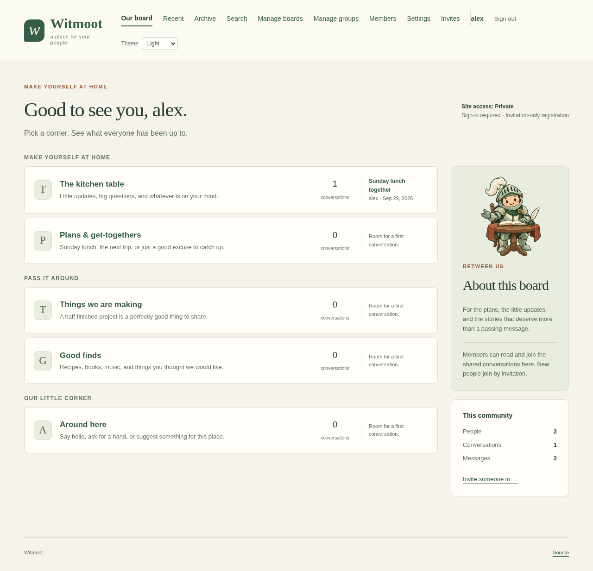

# Witmoot

A little corner of the internet for your people.

Witmoot is a bulletin board for a household, a family, or a group of friends.
It borrows rooms, topics, and conversations from phpBB and vBulletin, and keeps
them small and self-hosted.

Witmoot is part of **Comfyware**: software for friends and family, run by and
for the people using it. Each community sets its own rules, owns its data, and
can pack up and leave. There are no recommendation algorithms, infinite scroll,
streaks, or engagement targets. Just the plans, little updates, good finds, and
conversations worth coming back to. Read more in the
[Comfyware principles](docs/product.md#what-comfyware-means).

One Go binary and one data directory: server-rendered HTML, SQLite, and HTMX,
with no frontend build step and no outside service.

Sage and cream by day, dark greens by night. Pick **System**, **Light**, or
**Dark** from the header, and owners can switch the whole site to the Slate
colors. Meet the **Moot Knight**, a little keeper of the round
table with a book, a quill, and room for your people.



*A test instance with sample conversations.*

**Current release:** [0.24.0](docs/release-notes/0.24.0.md). Older versions are in the [release notes](docs/releases.md).

## Come on in

Want to look around first? With Go installed:

```sh
make demo
make demo PORT=9000   # another local port
```

Open <http://127.0.0.1:8082>. Sign in as **demo** (owner), **freya**, or
**jules** (members), all with the password **demo-password**. Every room has
sample conversations, some public, some for members, some for owners only.

- **The planning nook** is a private board: freya can post, jules can read, and
  visitors cannot see it. Change that under **Manage boards**.
- **Sunday regulars** is a group that lets both members post, with a Read only
  override for jules. **Manage groups** shows the result.
- **Archive** holds Last summer, a board of past conversations.

The demo listens on localhost, uses a temporary directory, and ignores your
`WITMOOT_*` settings. Ctrl-C stops it and deletes its data. Run `make help` for
every command.

## Set up your own board

Download a Linux binary or Debian package from
[GitHub Releases](https://github.com/airencracken/witmoot/releases) and follow
the [binary installation guide](docs/releases.md), or run the published image
with [Docker Compose](docs/containers.md).

Building from source? Requires Go 1.26.11 or later (or Go 1.27.4 or later on the
1.27 series).

```bash
make build
./bin/witmoot create-owner --username alex --password-prompt
./bin/witmoot
```

Scripts can pass the password on standard input with `--password-stdin`. New
builds can also authorize the first owner in the browser with `witmoot setup`;
see [common setup](docs/setup.md).

Open <http://127.0.0.1:8082> and sign in. New boards start in Private mode.
Choose **Settings** to change the mode and **Invites** to bring someone in.

For a permanent home, read the [deployment guide](docs/deployment.md) (source
installs, a Gentoo ebuild, OpenRC and systemd services, log rotation) and the
[proxy guide](docs/reverse-proxies.md). Caddy is the recommended proxy;
`witmoot proxy-config caddy --domain board.example.org` prints a site
configuration, and `nginx` or `apache` work too.

`witmoot --help` lists every command and setting.

## Who can see what

Owners choose the mode under **Settings**. It applies right away.

| Mode | Who can browse and post | Joining | New conversations |
| --- | --- | --- | --- |
| **Personal** | Owners only | Disabled, including invitations | Owners only |
| **Private** | Signed-in members and owners | Invitation required | Members only |
| **Open** | Visitors read public conversations; members post | Anyone can register | Public |

Each conversation keeps its audience when the mode changes, and replies share
it. Owners read everything. Members read public and members-only conversations.
Visitors read public conversations, and only in Open mode. Counts and search
follow the same rules.

**Open signup lets anyone become a member, and members can read members-only
conversations on shared boards.** Use a private board for anything closer.
Personal mode signs members out without deleting their accounts, and unexpired
invitations work again when you leave it.

If the audience changes while someone is writing, Witmoot keeps the draft and
asks them to check who will read it.

Accounts are created as members. Make owners on the command line with
`witmoot create-owner`.

## Boards and groups

Open the **Account** menu and choose **Manage boards** to create and rename
boards. Choose **Selected members only** to make a private board, then grant
access to groups or people.

**Manage groups** gathers people into named groups. Give a group **Read only**
or **Read and post** on a board, and membership changes apply at once. A
person's own setting beats every group: **No access**, **Read only**, or
**Read and post**. **Use groups** follows their groups, and the most generous
group grant wins. Without any grant, a private board stays hidden from the home
page, Recent, search, and counts, and so do its conversations and images.

Each group's page lists its boards and every member's effective access.

**Archive board** moves a board to the **Archive**: still readable and
searchable by the same people, closed to new messages until you restore it.
**Delete board permanently** shows what will go, asks you to type the board's
name, and cannot be undone. Images stay in Imvault.

## House rules and members

Under **Settings**, publish house rules and a way to reach the owners. **House
rules & owners** in the footer shows them to everyone, with owner usernames but
never email addresses.

Under **Members**, an owner can:

- **Suspend** a member: they are signed out everywhere, and their reset links and
  unused invitations stop working. Their messages and permissions stay.
  **Restore access** lets them sign in again.
- **Create a reset link** for someone locked out. It works once, expires after
  24 hours, and is shown once with a Copy button. With mail set up, **Email a
  reset link** sends it instead.
- **Remove avatar** for moderation.

Owners can also **Remove** a message. Its text and shared image links are
deleted for good and a placeholder keeps its place in the conversation. **View
owner activity** lists suspensions, restorations, and removals.

On the command line, `witmoot set-password --username NAME` replaces a password
and ends that account's sessions. `witmoot reset-link --username NAME
[--expires 48h]` prints a reset link, `witmoot list-users` lists accounts, and
`witmoot admin` opens an interactive account manager. When run as root, these
commands read the service configuration and act as the service user.

## Invitations

Under **Invites**, add an optional label, the number of accounts it may admit
(`0` for no limit), and an expiry in days (blank or `0` for never). Copy the link
or code when it appears; it is not shown again. The list shows each
invitation's uses, expiry, and status, with **Revoke invitation** for open ones.
Owners can let individual members invite people too.

Set `WITMOOT_BASE_URL` to your public address, such as
`https://board.example.org`, so links point to the right place behind a proxy.

## For members

- **Recent** shows each new message and reply from boards you can read, newest
  first. **Read in conversation** takes you to that exact message.
- **Search** finds conversations by title or message text, archived ones too.
- **Edit** your own messages while you can post. Edits show a timestamp and do
  not bump the conversation.
- **Your account** holds your profile (name, bio, and up to five links), your
  avatar, your timezone, your password and email, a download of your data, and
  account deletion. Turn off **Show animated avatars** to see still pictures
  everywhere.
- **Images** connects your [Imvault](docs/imvault.md) account, when the owner
  has set one up, so you can upload, pick from your library, or paste image
  links. Anyone who can read a conversation can see its images.
- Links from Songstead, the Comfyware app for music recommendations, and from
  Imvault albums can start a conversation or join a recent one. See
  [Comfyware connections](docs/suite.md).

Shared links stay links: Witmoot does not embed players, so opening a page does
not contact anyone else.

There are no private messages. Owner-only conversations are shared by all owners.

## Settings

| Setting | Default | Purpose |
| --- | --- | --- |
| `WITMOOT_NAME` | `Witmoot` | Name in the header and page titles |
| `WITMOOT_BASE_URL` | request origin | Public HTTP(S) address for invitation and reset links |
| `WITMOOT_DATA_DIR` | `./data` | Database and optional Imvault encryption key |
| `WITMOOT_ADDR` | `127.0.0.1:8082` | HTTP listen address |
| `WITMOOT_SECURE_COOKIES` | on for HTTPS | Set `true` to require secure cookies elsewhere |
| `WITMOOT_TRUSTED_PROXIES` | unset | Comma-separated proxy IPs or CIDRs allowed to report client addresses |
| `WITMOOT_IMVAULT_URL` | unset | Imvault server, such as `https://photos.example.org` |
| `WITMOOT_SMTP_HOST` | unset | SMTP relay; empty leaves mail off |
| `WITMOOT_SMTP_PORT` | `587` | Relay port |
| `WITMOOT_SMTP_USERNAME` | unset | Relay username |
| `WITMOOT_SMTP_PASSWORD` | unset | Relay password |
| `WITMOOT_SMTP_FROM` | `no-reply@` the base URL's domain | From address; required with a relay when the base URL has no domain name |
| `WITMOOT_SMTP_TLS` | `starttls` | `starttls`, `implicit`, or `none` |
| `WITMOOT_BACKUP_INTERVAL` | `24h` | Time between automatic backups; `0` turns them off |
| `WITMOOT_BACKUP_KEEP` | `7` | Automatic backups to keep |
| `WITMOOT_BACKUP_MAX_BYTES` | 10 GiB | Total size cap for kept backups |
| `WITMOOT_BACKUP_COPY_MAX_BYTES` | 5 GiB | Size cap for one uncompressed copy |
| `SSL_CERT_FILE` | system bundle | PEM bundle of trusted CAs, for example for a private relay |

```bash
WITMOOT_NAME='Our little corner' WITMOOT_ADDR=127.0.0.1:9000 make run
```

Site name, welcome text, mascot, favicon, house rules, and the footer version
live under **Settings** instead.

## Keeping the house in order

Put Witmoot behind an HTTPS proxy, keep its port private, and set
`WITMOOT_SECURE_COOKIES=true`.

Passwords use bcrypt and need at least 12 characters. Witmoot stores only hashes
of session, invitation, and reset tokens. Sessions last seven days. Forms carry
CSRF tokens, message text is escaped, and only bare `http://` and `https://`
addresses become links. Avatars are re-encoded, which removes camera details.
Sign-in, registration, and invitation use share a limit of 20 attempts per 15
minutes per address. Behind a proxy, list it in `WITMOOT_TRUSTED_PROXIES` so
visitors get their own limits; see
[running beside Imvault](docs/imvault.md#running-beside-imvault).

Witmoot backs itself up every day while it runs; owners see the status under
**Settings** → **Server**. See [automatic backups](docs/automatic-backups.md) for
retention, off-host copies, and recovery. For a manual backup, stop the server
and copy the whole data directory. Do not copy only the live `.db` file.

Taking your data with you is a Comfyware promise. Each member can download their
own messages and context from **Your account**, and owners can download a
community archive from **Settings**. Both open offline. See
[data portability](docs/data-portability.md).

Members can delete their account with their password. Their messages become
anonymous placeholders. The last owner must appoint another owner first.

The owner metrics page counts members, boards, conversations, messages, and
storage, plus site health (requests, errors, response times) and security
events such as failed sign-ins. Witmoot does not record who signed in or what
anyone read.

SQLite data is not encrypted at rest. Keep another copy of anything
irreplaceable.

Optional Linux confinement with Bubblewrap is described in
[the sandbox guide](docs/sandbox.md).

## Working on it

```bash
make help            # commands and installation options
make check           # formatting, vet, race tests, JavaScript tests, release config
make test-mutations  # deliberate defects the tests must catch (Python 3)
make build           # standalone binary, no cgo
```

Shared code comes from [Comfylib](https://github.com/airencracken/comfylib),
pinned in `go.mod`. To work on both, use an untracked workspace
(`go work init . ../comfylib`); do not commit a `replace` directive.

Browser checks need Node.js and Playwright:

```bash
npm --prefix scripts/browser ci
(cd scripts/browser && npx playwright install chromium)
make test-browser
```

They run an isolated instance with and without JavaScript. Set
`WITMOOT_SCREENSHOT_DIR` to keep screenshots. To test with a real Imvault
server, run `IMVAULT_BINARY=/path/to/imvault make test-imvault`.

The product direction lives in [docs/product.md](docs/product.md).

## License

Copyright (C) 2026 Marcus J. Hildum.

Witmoot is licensed under the GNU Affero General Public License, version 3 or
later (`AGPL-3.0-or-later`), like Imvault. See [LICENSE](LICENSE). It comes
without any warranty. Third-party components keep their own licenses; see
[THIRD_PARTY.md](THIRD_PARTY.md).

You can [support Witmoot on Ko-fi](https://ko-fi.com/airencracken).
